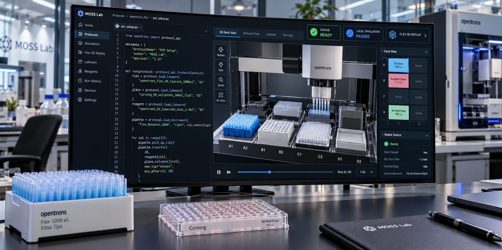
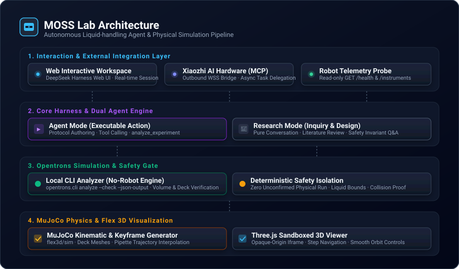
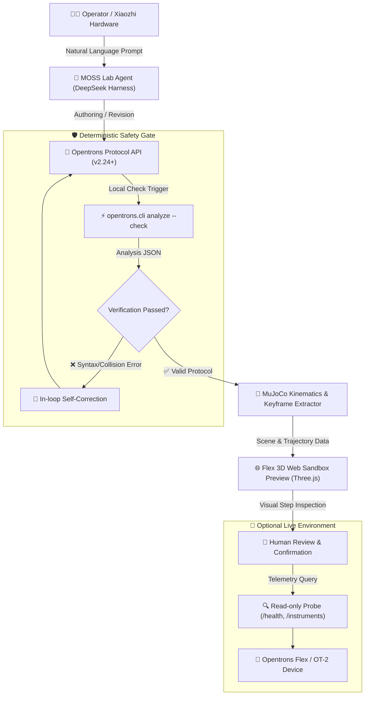

# MOSS Lab

English | [中文](README.zh.md)

[](LICENSE) [](https://nodejs.org/) [](https://www.python.org/) [](https://docs.astral.sh/uv/) [](https://github.com/cordiverse/cordis)


MOSS Lab brings a web-based AI agent, local Opentrons liquid-handling protocol simulation, and interactive Flex 3D keyframe visualization together into a unified platform. Built upon [DeepSeek Harness](https://github.com/deepseek-ai/deepseek-harness) and incorporating simulation assets from [LabscriptAI OT](https://github.com/KRATSZ/labscriptai-ot), MOSS Lab enables researchers to automate liquid-handling experimentation with deterministic safety isolation and real-time spatial physics feedback.

> **Project status:** Experimental. Local simulation and keyframe animations provide spatial validation, but do not establish wet-lab biological accuracy, machine readiness, or physical safety. The robot status monitor operates strictly in read-only telemetry mode and never triggers mechanical operations.

## Features

- **Dual-Mode Agent Architecture**: Seamlessly switch between executable Agent Mode (capable of tool invocations, code sandboxing, and protocol synthesis) and non-destructive Research Mode (dedicated to dialogue, literature synthesis, and design exploration).
- **Zero-Hardware Simulation Gate**: Verify Python protocol scripts locally with `opentrons.cli analyze --check` to catch out-of-bounds pipetting, deck collision, and parameter errors before hardware commitment.
- **Interactive Flex 3D Visualization**: Real-time rendering of Deck, Labware, and Pipette kinematics in an isolated Three.js web sandbox, driven by keyframes generated from MuJoCo physics models.
- **Xiaozhi AI Hardware Delegation**: Support for remote task dispatching and query via an outbound Xiaozhi MCP WebSocket connection without exposing credentials.
- **Read-Only Robot Telemetry**: Integrated non-intrusive status querying (`GET /health` and `GET /instruments`) to check robot availability safely.



## System Architecture

MOSS Lab decomposes biological automation into four resilient layers: User Interaction, Harness Core Governance, Protocol Simulation, and 3D Visualization.



### Workflow Lifecycle

The end-to-end execution pipeline ensures that no protocol reaches physical execution without deterministic local verification:



## Requirements

- Node.js 24.9 or later, with pnpm 11.28.5.
- [uv](https://docs.astral.sh/uv/) packaging tool and Python 3.11–3.13.
- An OpenAI Chat Completions-compatible HTTPS model service and credentials.
- A Xiaozhi MCP WSS endpoint for hardware delegation; an Opentrons HTTP endpoint is optional.

<a id="run"></a> <a id="run-from-source"></a>

## Getting Started

From the repository root, install Node dependencies and build the web bundle. The launcher installs the locked external plugin and its dependencies:

```sh
pnpm install
pnpm run build
```

Copy `.env.example` to `.env` and fill in your service credentials. Keep `.env` strictly local:

```sh
cp .env.example .env
node moss-start.mjs
```

Open the authenticated session URL printed in the terminal. Workspace sessions, experiment state, and compiled scenes are kept in `.dsh-local/`. Detailed migration guides can be found in [MOSS Lab setup](MOSS-LAB.md).

## Plugin updates

MOSS calls `simulate_protocol` and `protocol_artifacts` (artifact API v1). The plugin supplies portable animation and setup HTML; MOSS checks their digests and serves them only for the current authenticated session, revision, and analysis task. The plugin also supplies a checked file manifest for authenticated PNG/CSV/JSON downloads. It keeps no plugin source copy. Startup uses the committed lock and never selects a moving `latest` version.

The daily `labscriptai-sync` workflow checks published releases, updates the checksum lock, installs the candidate, and exercises both public tools before opening a draft upgrade PR. Merging the reviewed lock changes the next startup; running processes keep their current version. The initial lock pins the published v0.1.3 ZIP. The workflow logs and skips incompatible artifact API versions. To open draft PRs, the upstream repository must allow GitHub Actions to create pull requests. A maintainer can approve CI on the bot-created PR before merging. For plugin development, set `LABSCRIPTAI_OT_ROOT` to a local checkout; the startup log marks it `development`. Run `node --import tsx/esm scripts/check-labscriptai.mjs` to check the locked runtime without a model or robot.

## Continuous integration

The MOSS web workflow runs the complete build, experiment and Xiaozhi regressions, pinned-plugin checks, and built web boot tests for pull requests and pushes to `main`. A new commit cancels an older run of the same pull request; main push builds finish independently. The upstream Harness CI, Windows, release-package, native-addon, and Cloudflare preview pull-request workflows target `master`. Real-API checks run automatically only for `master`, remain available through manual dispatch, and have no nightly schedule. Weighted approval applies only to pull requests targeting `master`. The MOSS uv cache key reads only the plugin lock, avoiding traversal of pnpm workspace symlinks. Linux toolchain installation precedes dependency installation and builds; an apt index error stops the job before either starts.

## Configuration

The runtime reads its configuration from the root `.env` file:

| Environment Variable | Requirement | Description | Example |
|---|---|---|---|
| `AI_API_KEY` | Required | Authentication token for your OpenAI-compatible model service | `sk-xxxxxx` |
| `AI_API_URL` | Required | Target HTTPS chat completion endpoint URL | `https://api.deepseek.com/v1/chat/completions` |
| `AI_MODEL` | Required | Model designation identifier to invoke | `deepseek-chat` |
| `XIAOZHI_WSS_URL` | Required | Private WebSocket URL for Xiaozhi MCP communication | `wss://api.example.com/mcp?token=xxx` |
| `OPENTRONS_URL` | Optional | Address of the target Opentrons robot server | `http://192.168.1.100:31950` |

## Project Layout

- `moss-start.mjs` and `moss-model.patch.yml` configure and launch the Cordis web agent.
- `internal/` houses the experiment store, preview recovery engine, robot telemetry, and Xiaozhi bridge.
- `labscriptai-ot.lock.json` pins the external plugin archive, artifact API, version, and SHA-256; managed installs live in `.dsh-local/plugins/`.
- `packages/`, `apps/`, and `vendor/` provide the core DeepSeek Harness architecture and web client.

## Sources and Citation

MOSS Lab builds on [DeepSeek Harness](https://github.com/deepseek-ai/deepseek-harness) by DeepSeek AI and [LabscriptAI OT](https://github.com/KRATSZ/labscriptai-ot). MOSS calls its public MCP tools; simulation, animation, setup figures, fonts, and rendering code stay in the plugin repository.

Any research, publication, or public system utilizing LabscriptAI OT must cite:

> Gao, Yuan et al. “Autonomous Liquid-handling Robotics Scripting for Accessible and Responsible Protein Engineering.” bioRxiv, 2025. [doi:10.1101/2025.09.30.679666](https://doi.org/10.1101/2025.09.30.679666).

Refer to [LabscriptAI OT citation metadata](https://github.com/KRATSZ/labscriptai-ot/blob/main/CITATION.cff) and [DeepSeek Harness citation](https://github.com/deepseek-ai/deepseek-harness#citation).

## License

This repository is distributed under a mixed-licensing model. DeepSeek Harness components are covered by the [MIT license](LICENSE). The separately installed LabscriptAI OT plugin is licensed under the [LabscriptAI Research Citation License v1.0](https://github.com/KRATSZ/labscriptai-ot/blob/main/LICENSE), which requires academic citation and prior written authorization for commercial deployment; it is not an OSI-approved open-source license. Third-party protocol examples within the library retain their respective author copyrights. See [third-party notices](THIRD_PARTY_NOTICES.md) for full attribution details.
