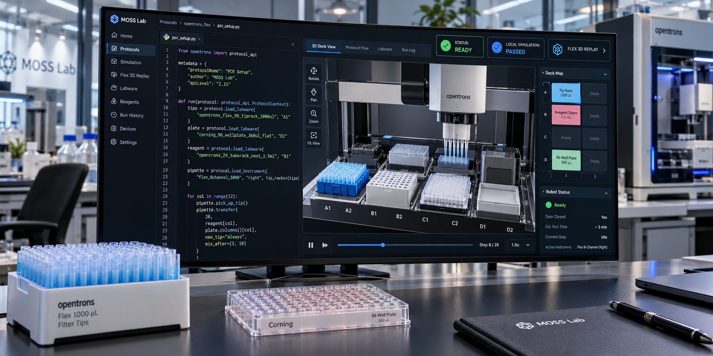
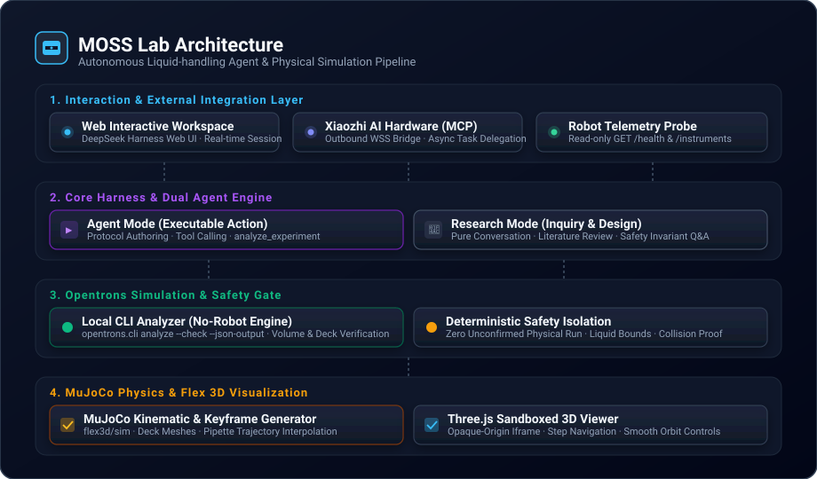
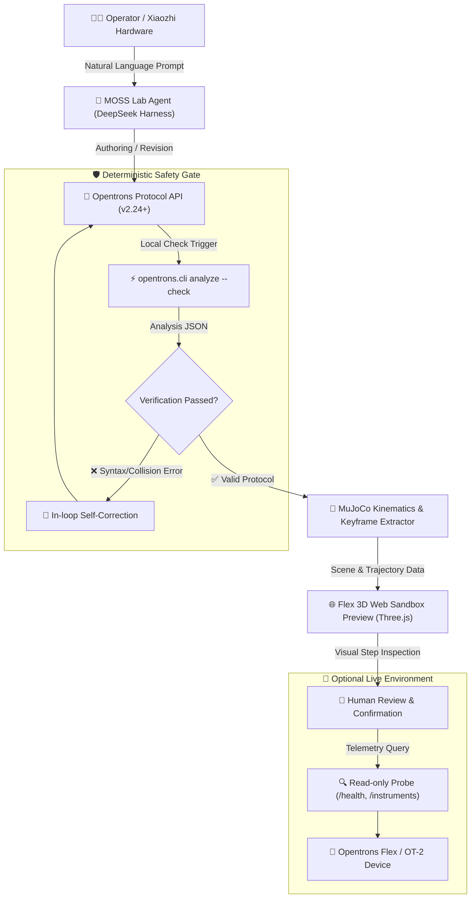

# MOSS Lab

[English](README.md) | 中文

[](LICENSE) [](https://nodejs.org/) [](https://www.python.org/) [](https://docs.astral.sh/uv/) [](https://github.com/cordiverse/cordis)


MOSS Lab 将网页 AI 智能体、本地 Opentrons 移液协议仿真与交互式 Flex 3D 关键帧可视化整合为一个统一平台。项目基于 [DeepSeek Harness](https://github.com/deepseek-ai/deepseek-harness) 架构，并融合了来自 [LabscriptAI OT](https://github.com/KRATSZ/labscriptai-ot) 的机器人自动化与物理仿真资产，使科研人员能够借助确定性的本地安全隔离机制与实时物理空间反馈，高效开展移液自动化实验。

> **项目状态：** 实验阶段。本地模拟与关键帧动画仅提供空间逻辑验证，不能证明湿实验生物学准确性、物理机器就绪或操作安全。机器人状态监控模块仅工作在只读遥测模式下，绝不会主动触发实体硬件机械动作。

## 核心特性

- **双模式智能体架构**：无缝切换可执行工具的“Agent 模式”（支持工具调用、代码沙箱与协议自动编写）与纯文本对话的“调研模式”（专注于文献综述、实验逻辑推演与安全性探讨）。
- **零硬件门槛仿真关卡**：通过 `opentrons.cli analyze --check` 在本地环境中对生成的 Python 协议进行严格静态语法与几何冲突检查，在接触实体硬件前提前拦截移液量超限、板位干涉等隐患。
- **Flex 3D 交互式可视化**：利用 MuJoCo 物理引擎精确计算吸液、排液和移液臂运动轨迹，并在隔离的 Three.js 网页沙箱中提供沉浸式三维漫游与单步关键帧预览。
- **小智 AI 硬件跨端委派**：支持通过安全的外部 WSS 通道连接小智 MCP 智能硬件，实现语音/移动端随时委派实验任务并实时追踪进度，凭据严格保密。
- **只读机器人遥测探测**：轻量级集成无副作用的只读状态查询（`GET /health` 与 `GET /instruments`），安全探测现场设备就绪状态。



## 系统架构

MOSS Lab 将生物实验自动化解耦为四个健壮层级：用户交互层、Harness 核心治理层、协议仿真层与 3D 可视化层。



### 执行工作流程

端到端执行流水线确保任何未经本地仿真验证的协议都不会进入实体运行阶段：



## 环境要求

- Node.js 24.9 或更高版本，配合 pnpm 11.28.5。
- [uv](https://docs.astral.sh/uv/) 包管理工具及 Python 3.11–3.13 运行环境。
- 兼容 OpenAI Chat Completions 的 HTTPS 模型服务地址与凭据。
- 小智 MCP 硬件委派所必需的 WSS 接入地址；可选配置 Opentrons 设备 HTTP 地址。

<a id="run"></a> <a id="run-from-source"></a>

## 快速开始

在项目根目录安装 Node 依赖并构建网页产物；启动器会安装锁定的外部插件及其依赖：

```sh
pnpm install
pnpm run build
```

将环境配置文件模板 `.env.example` 复制为 `.env`，填入服务凭据。请务必妥善保管 `.env`，切勿公开：

```sh
cp .env.example .env
node moss-start.mjs
```

启动完成后，在浏览器中打开终端打印的授权登录链接。会话状态、实验快照与场景缓存均保存在本地 `.dsh-local/` 中。历史数据迁移说明参见 [MOSS Lab 配置与迁移指南](MOSS-LAB.md)。

## 插件更新

MOSS 调用 `simulate_protocol` 和 `protocol_artifacts`（产物接口 v1）。插件提供独立的动画与配置图 HTML；MOSS 校验摘要，并仅向当前已认证的会话、实验版本及分析任务提供页面，插件还提供经过校验的文件清单，用于受认证的 PNG/CSV/JSON 下载；不保留插件源码副本。启动使用已提交的锁文件，不会临时选择变化中的 `latest` 版本。

每日 `labscriptai-sync` 工作流检查正式发布，更新归档摘要锁，安装候选版本并测试两个公开工具，通过后才创建升级草稿 PR。审查合并锁文件后，下次启动采用新版本；运行中的进程保留当前版本。初始锁固定到已发布的 v0.1.3 ZIP。遇到不兼容的产物接口版本，工作流会记录原因并跳过。上游仓库须允许 GitHub Actions 创建 PR，维护者可在合并前批准机器人 PR 的 CI。开发插件时可将 `LABSCRIPTAI_OT_ROOT` 指向本地仓库，启动日志会标记 `development`。运行 `node --import tsx/esm scripts/check-labscriptai.mjs` 可检查锁定版本，无需模型或机器人。

## 持续集成

MOSS web 工作流对拉取请求和 `main` 推送执行完整构建、实验与小智回归、锁定插件检查及构建后的 Web 启动测试。同一拉取请求有新提交时取消旧运行；main 推送构建独立完成。上游 Harness CI、Windows、发布打包、原生扩展和 Cloudflare 预览的拉取请求工作流仅针对 `master`。真实 API 检查仅对 `master` 自动运行，保留手动触发并取消每晚定时运行。加权审批仅用于目标分支为 `master` 的拉取请求。MOSS 的 uv 缓存键只读取插件锁文件，避免遍历 pnpm 工作区符号链接。Linux 工具链先于依赖安装和构建安装；apt 索引错误会在这两步开始前终止任务。

## 环境变量配置

系统启动时从根目录下的 `.env` 文件读取关键运行时配置：

| 环境变量 | 必填项 | 详细描述 | 示例值 |
|---|---|---|---|
| `AI_API_KEY` | 必填 | 兼容 OpenAI 接口规范的模型服务访问密钥 | `sk-xxxxxx` |
| `AI_API_URL` | 必填 | 模型服务的 HTTPS 对话补全接口完整地址 | `https://api.deepseek.com/v1/chat/completions` |
| `AI_MODEL` | 必填 | 所调用的后端大语言模型标识名称 | `deepseek-chat` |
| `XIAOZHI_WSS_URL` | 必填 | 用于小智硬件 MCP 双向通信的私有 WebSocket 地址 | `wss://api.example.com/mcp?token=xxx` |
| `OPENTRONS_URL` | 选填 | 局域网内 Opentrons 机器人的服务基础地址 | `http://192.168.1.100:31950` |

## 项目结构

- `moss-start.mjs` 与 `moss-model.patch.yml`：负责配置并启动 Cordis 网页智能体框架。
- `internal/`：存放实验存储库、重启恢复引擎、只读机器人遥测与小智 MCP 桥接插件。
- `labscriptai-ot.lock.json`：锁定外部插件归档、产物接口版本、插件版本和 SHA-256；安装目录为 `.dsh-local/plugins/`。
- `packages/`、`apps/` 与 `vendor/`：DeepSeek Harness 核心插件基础设施与前端 Web 客户端。

## 来源与引用

MOSS Lab 构建于 DeepSeek AI 开发的 [DeepSeek Harness](https://github.com/deepseek-ai/deepseek-harness) 以及 [LabscriptAI OT](https://github.com/KRATSZ/labscriptai-ot)。MOSS 调用插件公开的 MCP 工具；模拟、动画、配置图、字体及渲染代码统一维护在插件仓库。

任何利用 LabscriptAI OT 开展的研究成果、学术出版物或公开系统均须引用以下论文：

> Gao, Yuan et al. “Autonomous Liquid-handling Robotics Scripting for Accessible and Responsible Protein Engineering.” bioRxiv, 2025. [doi:10.1101/2025.09.30.679666](https://doi.org/10.1101/2025.09.30.679666).

更多信息参见 [LabscriptAI OT 引用元数据](https://github.com/KRATSZ/labscriptai-ot/blob/main/CITATION.cff) 与 [DeepSeek Harness 引用指南](https://github.com/deepseek-ai/deepseek-harness#citation)。

## 许可证

本项目采用混合许可证管理体系。DeepSeek Harness 原有模块遵循 [MIT 许可证](LICENSE)。单独安装的 LabscriptAI OT 插件遵循 [LabscriptAI Research Citation License v1.0](https://github.com/KRATSZ/labscriptai-ot/blob/main/LICENSE)，该协议要求学术引用，且商业使用须取得事先书面授权，不属于 OSI 认证的通用开源许可证。随附协议库中的第三方示例协议保留原作者版权声明。完整信息请查阅[第三方声明文件](THIRD_PARTY_NOTICES.md)。
